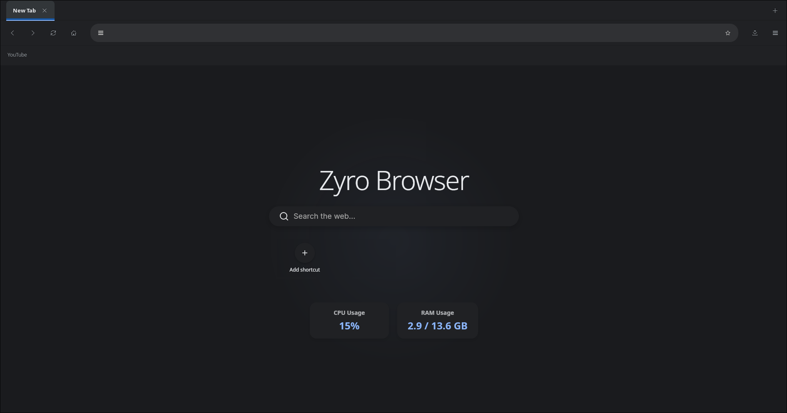
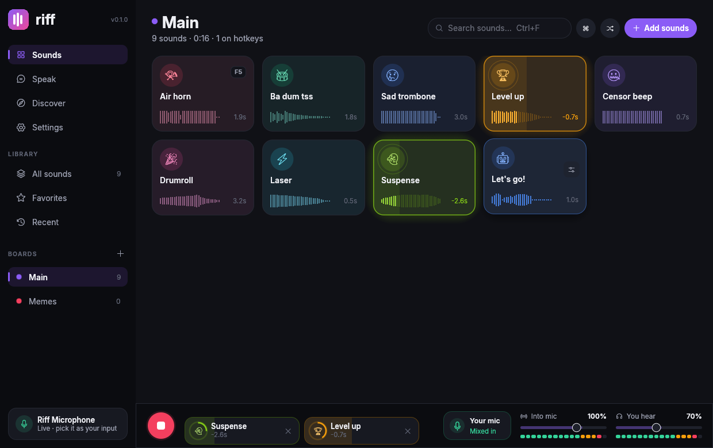
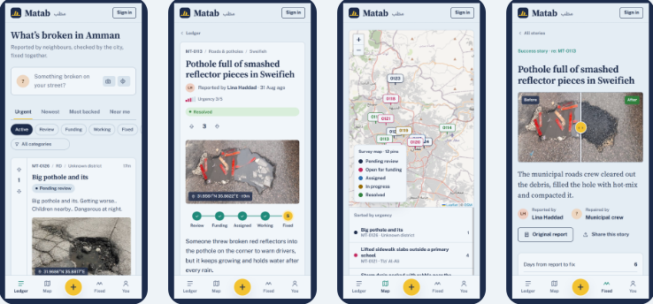
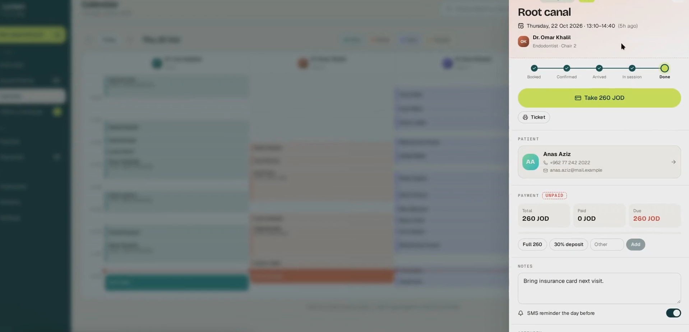

<table>
<tr>
<td>

<b>Hey! I'm Sadeq 👋</b> 
Full-stack developer · Software Engineer · Amman, Jordan · <a href="https://sardeq.github.io/">portfolio</a>

</td>
</tr>
<tr>
<td>

</td>
</tr>
<tr>
<td>
<b>languages</b> 
<code> C#</code>
<code> C++</code>
<code> Rust</code>
<code> TypeScript</code>
<code> JavaScript</code>
</td>
</tr>
<tr>
<td>
<b>backend</b> 
<code> .NET</code>
<code> Node.js</code>
<code> Express</code>
<code> PostgreSQL</code>
<code> Supabase</code>
</td>
</tr>
<tr>
<td>
<b>frontend</b> 
<code> React</code>
<code> Bootstrap</code>
<code> Figma</code>
</td>
</tr>
<tr>
<td>
<b>systems & tools</b> 
<code> Linux</code>
<code> NixOs</code>
<code> Unity</code>
<code> Git</code>
</td>
</tr>
</table>
