<div align="center">



<br />

<a href="https://sardeq.github.io/Portfolio/"></a>
<a href="https://www.linkedin.com/in/sadeqodeh/"></a>

</div>

<br />

```csharp
public sealed class Sadeq : Developer
{
    public string   Role      => "Full-stack developer";
    public string   Studying  => "B.Sc. Computer Science @ Al Hussein Technical University";
    public string   Based     => "Amman, Jordan";
    public string[] Speaks    => ["Arabic", "English"];
    public string[] Building  => ["Zyro Browser v2", "AI document digitization (grad project)"];
}
```

<br />

## 🧰 Stack

<p align="center">
  <sub><b>BACKEND</b></sub><br />
  
</p>
<p align="center">
  <sub><b>FRONTEND & MOBILE</b></sub><br />
  
</p>
<p align="center">
  <sub><b>SYSTEMS, GAMES & TOOLS</b></sub><br />
  
</p>

<br />

## 🚀 Featured work

<table>
<tr>
<td width="50%" valign="top">

### [Zyro Browser](https://github.com/sardeq/Zyro-Browser)
A lightweight desktop browser written in C++. v1 ran on WebKitGTK and hit memory-concurrency walls, so it's [archived](https://github.com/sardeq/Zyro-Browser-old) and being rebuilt on a Chromium-style architecture.

`C++` `WebKitGTK` `Linux`

</td>
<td width="50%" valign="top">

### [BoomBx](https://github.com/sardeq/BoomBx)
A free soundboard that plays audio through a virtual microphone.

`HTML` &nbsp; ⭐ 8

</td>
</tr>
<tr>
<td width="50%" valign="top">

### Matab · مطب
Civic platform where citizens report damaged infrastructure, crowdfund repairs, and contractors bid on the work. An AI model screens reports: confident calls are auto-approved, the rest go to human admins.

`React` `TypeScript` `Supabase` `Gemma`

</td>
<td width="50%" valign="top">

### Transport document digitization
Graduation project: an AI platform that digitizes Arabic and English transport documents. I'm the full-stack dev on a team of three.

`AI / OCR` `Full-stack` `In progress`

</td>
</tr>
<tr>
<td width="50%" valign="top">

### [Workmint](https://github.com/sardeq/workmint-frontend)
Freelance marketplace with admin, freelancer and client roles, covering the whole flow from approvals and revisions to payments. [Backend repo →](https://github.com/sardeq/workmint-backend)

`React` `Express` `PostgreSQL`

</td>
<td width="50%" valign="top">

### [AJU-RegSystem](https://github.com/sardeq/AJU-RegSystem)
Registration system built as a freelance project for a client.

`Freelance`

</td>
</tr>
</table>

<br />

## 📊 GitHub

<p align="center">
  
  
</p>
